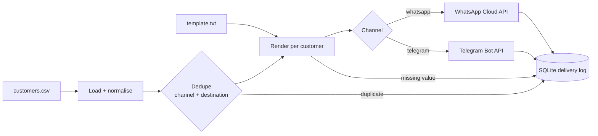

# ShopNotify

Order-alert notifications for a small shop: take a CSV of customers,
render a personalised message for each one from a template, send it
over Telegram or WhatsApp, and keep a complete delivery log — who got
their alert, who failed and why, and who was skipped before sending.

```
shopnotify send --csv examples/customers.csv \
    --template examples/templates/order_ready.txt --dry-run
```

## How it works



Every stage is a small module with one job:

| Module | Responsibility |
|---|---|
| `customers.py` | Load the CSV, normalise phone numbers, default the channel, dedupe recipients |
| `templating.py` | `{{merge tag}}` rendering; strict about missing values |
| `senders.py` | Telegram and WhatsApp clients behind one `Sender` interface, over an injectable HTTP transport |
| `retry.py` | Backoff wrapper used by the senders (429/5xx, Retry-After aware) |
| `delivery_log.py` | SQLite log of every processed row, with CSV export |
| `notifier.py` | Orchestration (dedupe → render → pace → send → log), rate limiter and CLI |
| `config.py` | Settings from the environment / `.env` |

## Quick start

### Local (venv)

```bash
python -m venv .venv && source .venv/bin/activate
pip install -e .
cp .env.example .env   # add a bot token (see below)
```

### Docker

```bash
cp .env.example .env
docker compose up --build   # runs the bundled example as a dry run
```

## Try it

The bundled example is safe to run as-is — a dry run contacts nobody:

```bash
shopnotify send --csv examples/customers.csv \
    --template examples/templates/order_ready.txt --dry-run
```

```
skipped: Sara Ahmadi (telegram 512345678): duplicate recipient in this run
skipped: Karl Jensen (telegram 777222111): no value for template tag(s): amount
run 3fa9c1e2b807: 7 row(s): sent=0, failed=0, skipped=2, dry_run=5
```

The example CSV deliberately contains the same customer twice (an
online export merged with a spreadsheet) and one row with an empty
amount, so you can watch dedupe and the strict renderer do their work.
Drop `--dry-run` to actually send; the summary then reads
`sent=5, skipped=2`. Afterwards:

```bash
shopnotify report                 # counts by status
shopnotify report --csv-out deliveries.csv
```

## Inputs

**Customers CSV** — header row required:

```csv
name,phone,telegram_chat_id,channel,order_id,amount,item
Sara Ahmadi,+98 912 345 6789,512345678,telegram,1042,250000,Running shoes
```

- `channel` is `telegram` or `whatsapp`; left blank it defaults to
  WhatsApp when a phone number exists, otherwise Telegram.
- Phone numbers are normalised to `+<digits>`; numbers without a
  country code get `DEFAULT_COUNTRY_CODE` prepended (or pass
  `--country-code 98`).
- Any extra columns (`item`, `eta`, ...) become merge tags.

**Template** — plain text with `{{tags}}`. Every column can be used,
plus `name`, `phone`, `telegram_chat_id`, `channel` and `order_id`:

```
Hi {{name}}, good news — your order {{order_id}} ({{item}}) is ready for pickup.
Total: {{amount}}. Just mention your name at the counter.
```

**Channels**

- *Telegram* (primary): set `TELEGRAM_BOT_TOKEN` (from @BotFather).
  A customer has a chat id only after opening the bot and pressing
  Start, so collect ids at checkout or via a `/start` deep link.
- *WhatsApp*: set `WHATSAPP_TOKEN` and `WHATSAPP_PHONE_NUMBER_ID`
  from the Meta app dashboard. One platform rule matters here:
  outside a 24-hour customer-service window WhatsApp only allows
  pre-approved template messages, so order alerts work best in reply
  to — or soon after — a customer interaction.

## Design decisions

**Strict rendering.** A tag with no value (or an empty one) aborts
that message and is logged as `skipped`, naming the missing tags.
The alternative — sending "Hi , your order is ready" — is worse than
not sending.

**Nothing is silently dropped.** Duplicates, undeliverable rows,
rendering failures and provider errors all land in the delivery log
with a reason. The log is SQLite (`deliveries.db`), one row per
customer per run, including the rendered text, so any run can be
audited and exported to CSV.

**Dedupe by channel + destination.** Within one run, the first row
for a given chat id or phone number wins. The same person reachable
on both channels is *not* a duplicate — the CSV chooses the channel.

**Pacing and retries.** Sends are spaced by a rate limiter
(`SEND_INTERVAL_SECONDS`, default 1s) and each send is retried on
429/5xx/connection errors with exponential backoff that honours the
provider's retry-after hint. Client errors (unknown chat, number not
on WhatsApp) fail immediately — retrying them would not help.

**Pluggable senders, offline tests.** Both providers sit behind the
same `Sender` interface and an injectable HTTP transport, so adding a
channel is one small class, and the test suite stubs the transport
instead of touching the network. A dry run renders and logs exactly
what *would* be sent, which is how a new template gets proofread.

## Tests

```bash
pip install pytest
pytest
```

The suite runs fully offline and covers merge-tag rendering
(including the missing-value rules), CSV loading and phone
normalisation, recipient dedupe, both senders' request shapes and
error mapping, the retry wrapper (delays are recorded, not slept),
delivery-log writes and summaries, the rate limiter, and end-to-end
runs over the bundled example.

## Project layout

```
shopnotify/      package (models, templating, customers, senders,
                 retry, delivery_log, config, notifier/CLI)
examples/        sample customers CSV + message templates
tests/           pytest suite
```
